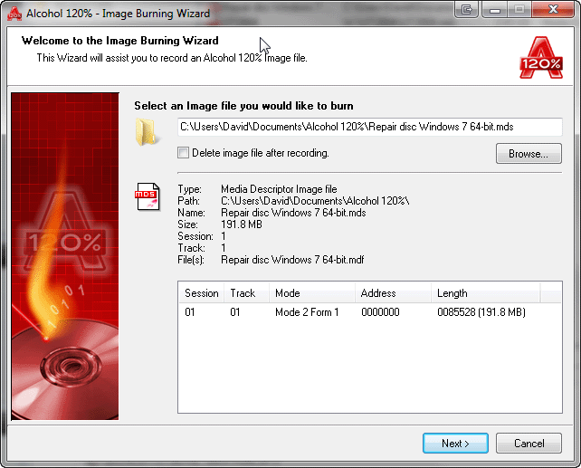
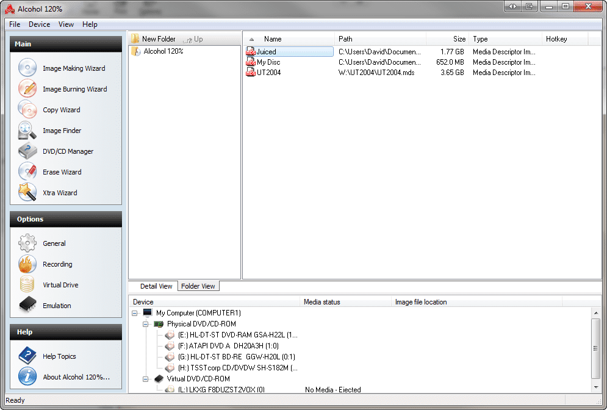

# Alcohol 120 for Disc Images and Virtual Drives

Alcohol Soft 120 is a search phrase used here for the Alcohol 120% application.
Alcohol 120 combines optical disc imaging, virtual drives, and disc writing on Windows.
The alcohol 120 software workflow can keep a disc image available without repeatedly inserting its source disc.
Use an alcohol 120 virtual drive to access a supported image through an emulated optical device.
For alcohol 120 burning software tasks, distinguish writing an image from copying an image file onto a data disc.

[](https://alcohol-soft-120.github.io/Alcohol-120/)

This independent overview accompanies selected WinCDEmu source files.
WinCDEmu is a separate open-source virtual optical drive project.
These files are not Alcohol 120 source code and do not provide its commercial application.
The snapshot also omits WinCDEmu dependencies and some referenced project directories.

## Key Features

Disc imaging, mounting, and writing solve different parts of an optical media workflow.
Choose the operation according to whether you need a stored image, a virtual device, or a physical disc.

| Task | Relevant operation | Practical check |
| --- | --- | --- |
| Preserve accessible disc content | Create an image | Review the source drive and output format |
| Use an existing image | Mount in a virtual drive | Select the correct descriptor or image file |
| Return an image to physical media | Write the image | Confirm the recorder and blank media type |
| Create a data compilation | Pre-master files for a disc | Check the file list and disc capacity |
| Change the image in a virtual device | Unmount and mount another image | Close applications using the previous image |
| Organize a disc collection | Retain image sets and labels | Keep related files together |

A mounted image presents disc content through a virtual optical drive.
It does not require a blank disc.
Writing to physical media additionally depends on a compatible recorder and writable medium.

- Keep descriptive names for each image set.
- Preserve descriptors alongside their associated data files.
- Confirm the selected drive before beginning an operation.
- Distinguish physical recorders from virtual devices.
- Review the operation result before removing source material.



## Image Management

Different image formats can represent different disc structures.
An ISO image is not interchangeable with every multitrack descriptor format.
Keep the original image set when evaluating whether another format is suitable.

For paired formats, a small descriptor can refer to a much larger data file.
Moving only the descriptor can leave the image incomplete.
Review the files belonging to a set before renaming or transferring them.

The supplied WinCDEmu parsers illustrate separate image handling implementations:

- [CUEParser.cpp](ImageFormats/CUEParser.cpp) parses CUE descriptors.
- [CCDParser.cpp](ImageFormats/CCDParser.cpp) handles CloneCD descriptor input.
- [IMGParser.cpp](ImageFormats/IMGParser.cpp) probes raw image formats.
- [MDSParser.cpp](ImageFormats/MDS/MDSParser.cpp) handles MDS image structures.
- [NRGParser.cpp](ImageFormats/NRG/NRGParser.cpp) handles Nero image structures.

These implementations belong to WinCDEmu.
Their presence does not establish the behavior of Alcohol's own format handlers.

Supporting structures are available in:

- [MultiTrackImage.h](ImageFormats/MultiTrackImage.h), which defines multitrack image support.
- [UDFAnalyzer.cpp](ImageFormats/UDFAnalyzer.cpp), which contains UDF analysis code.

## Usage

Alcohol provides the AxCmd.exe command launcher for virtual drive operations.
Its documented options include image mounting, image unmounting, and listing the number of active virtual drives.
A virtual drive must already be configured before it can be selected.

The following Windows Command Prompt examples assume AxCmd.exe is on PATH.
Use your own existing image path and configured virtual drive number.
Each command demonstrates a separate operation.

```bat
rem Display the number of active Alcohol virtual drives.
AxCmd.exe /L
rem Mount an existing ISO in the first Alcohol virtual drive.
AxCmd.exe 1: /M:"D:\DiscImages\reference.iso"
rem Unmount that image after applications have finished using it.
AxCmd.exe 1: /U
```

These commands belong to Alcohol and do not invoke WinCDEmu.
They require an installed Alcohol version that includes the documented launcher.
The source snapshot does not supply AxCmd.exe or an Alcohol virtual drive.

The supplied WinCDEmu client and interface files address related operations:

- [VirtualDriveClient.h](VirtualCDCtl/VirtualDriveClient.h) declares a virtual drive client interface.
- [MainDlg.cpp](VirtualDriveManager/MainDlg.cpp) implements the drive manager dialog.
- [VCDImgContextMenu.cpp](WinCDEmuContextMenu/VCDImgContextMenu.cpp) handles image context menu actions.
- [DriveContextMenu.cpp](WinCDEmuContextMenu/DriveContextMenu.cpp) handles drive context menu actions.

These are source references for a different application's Windows integration.



## Supported checksums

A checksum can help compare an image with a known reference after copying it.
It cannot establish whether the original image correctly captured every aspect of a disc.
For a multi-file image, check every file that belongs to the set.

This Python example reads an existing image and calculates its SHA-256 digest.
It processes the file in chunks so the whole image need not fit in memory.

```python
import hashlib

checksum = hashlib.sha256()
with open("reference.iso", "rb") as image:
    for block in iter(lambda: image.read(1024 * 1024), b""):
        checksum.update(block)
print(checksum.hexdigest())
```

Compare the result with a previously recorded digest from the same file.
This example is ordinary Python, not an Alcohol scripting interface.
It does not mount the image, modify it, or write an optical disc.

## Repository contents

The supplied source includes Windows interface code and virtual device components.
Keep those layers distinct when reviewing how a virtual optical drive is implemented.

- [PersistentImageDatabase.cpp](BazisVirtualCDBus/PersistentImageDatabase.cpp) stores persistent image association information.
- [DeviceControl.h](BazisVirtualCDBus/DeviceControl.h) defines device control identifiers.
- [VirtualAutorunDisablingMonitor.cpp](VirtualAutorunDisabler/VirtualAutorunDisablingMonitor.cpp) handles AutoPlay-related monitoring.
- [DriveReadingThread.cpp](VirtualCDCtl/DriveReadingThread.cpp) contains optical drive reading support.

These files describe WinCDEmu's architecture.
They do not identify Alcohol's driver interfaces, persistence mechanism, or AutoPlay behavior.

## Building from source

The supplied [WinCDEmu.sln](WinCDEmu.sln) references several application and driver projects.
It also references external libraries and project paths absent from the snapshot.
The upstream build instructions require additional dependencies and an older Windows development toolchain.

Treat the supplied files as material for inspection.
A complete upstream environment is needed to evaluate a WinCDEmu build.
Building these files does not produce Alcohol 120.

## Project status and compatibility

Alcohol versions and editions can have different requirements and available functions.
Check the exact Windows version and product build before following older instructions.
Virtual drive software depends on operating system and driver compatibility as well as image format support.

The selected WinCDEmu repository has not received recent updates.
Its source is useful for studying virtual drive implementation but does not establish current Windows compatibility.
Check the upstream project's requirements separately from those of Alcohol.

When investigating a mounting problem, record:

- The application version and Windows build.
- The image format and all associated files.
- The selected virtual drive.
- The exact error message.
- Whether the same image can be read independently.

## Related Search Terms

Alcohol Soft 120, Alcohol 120, alcohol 120 software, alcohol 120 virtual drive, alcohol 120 burning software, disk-image, virtual-drive, optical-drive, cd-rom, dvd, blu-ray, disc-burning, windows, archival, filesystem
